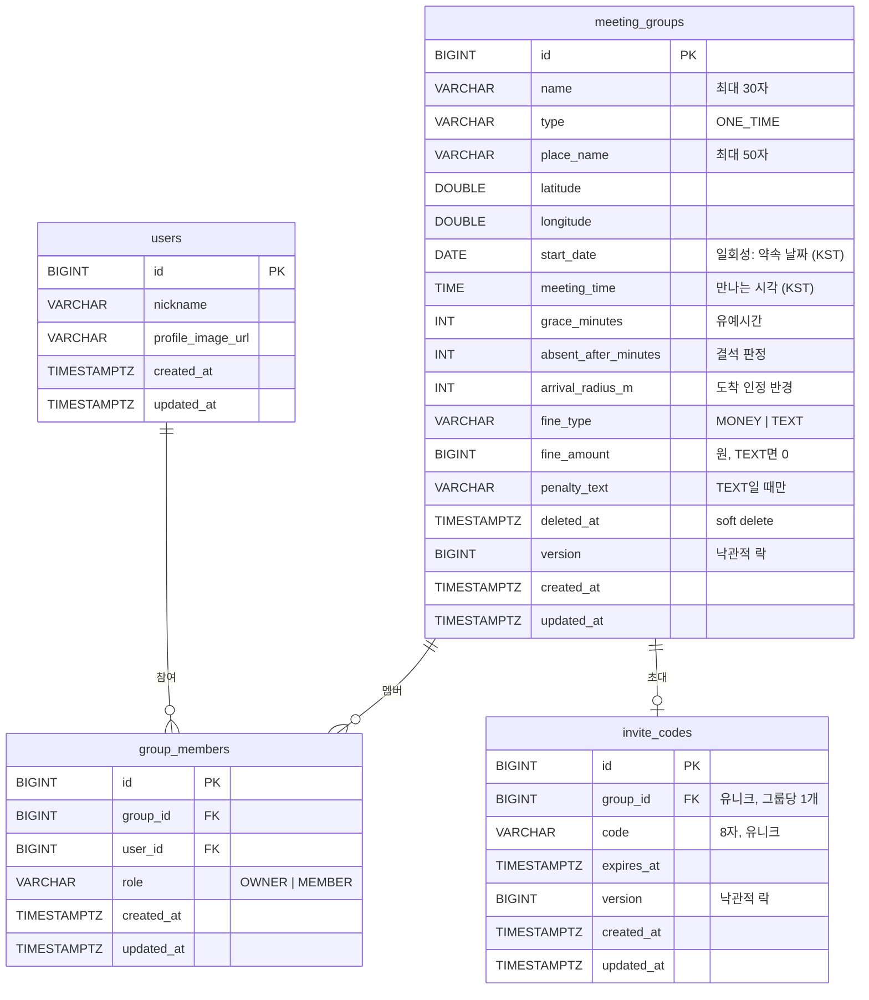

# OnTime Backend

약속(친구 약속, 스터디, 정기 모임)에서 멤버의 출발/도착 상태를 공유하고,
약속 시간까지 도착하지 않은 멤버에게 미리 정한 벌금이나 벌칙을 자동으로 매기는 서비스의 백엔드입니다.

- 코드 규칙과 도메인 규칙: [`CLAUDE.md`](CLAUDE.md)
- 진행 상황: [`docs/ROADMAP.md`](docs/ROADMAP.md)

> 이 문서는 설계의 기준입니다. 기능을 추가하는 이슈마다 해당 범위의 ERD와 API 명세를 이 문서에 더합니다.
> 아직 구현 범위에 들어오지 않은 테이블(회차, 참석, 벌금 원장 등)은 해당 이슈에서 추가합니다.

## 기술 스택

Java 17, Spring Boot 4.1, Spring Data JPA (Hibernate 7), PostgreSQL 18, Redis 7.4,
JUnit 5, Testcontainers

## 실행

```bash
docker compose up -d   # PostgreSQL, Redis
./gradlew bootRun      # profile: local
./gradlew test         # Docker 필요 (Testcontainers)
```

Swagger: http://localhost:8080/swagger-ui.html

## ERD

시각은 `TIMESTAMPTZ`(UTC 저장)입니다. 날짜(`DATE`)와 만나는 시각(`TIME`)은 KST 기준 값입니다.
enum은 `VARCHAR` + `CHECK` 제약으로 저장합니다.



### meeting_groups

| 컬럼 | 규칙 |
| --- | --- |
| `type` | 지금은 `ONE_TIME` 만 생성합니다. 정기 모임(`RECURRING`, 기간과 요일)은 Phase 3에서 추가합니다. |
| `start_date` + `meeting_time` | KST 기준 약속 일시. 생성할 때 서버 시각보다 뒤여야 합니다. |
| `grace_minutes` | 0~60분 |
| `absent_after_minutes` | 1~180분, `grace_minutes` 보다 커야 합니다. |
| `arrival_radius_m` | 50~1000m |
| `fine_type`, `fine_amount`, `penalty_text` | `MONEY` 면 `fine_amount` 1~1,000,000원 필수, `penalty_text` 는 저장하지 않습니다. `TEXT` 면 `penalty_text` 필수(최대 100자), `fine_amount = 0` 입니다. |
| `version` | `@Version` 낙관적 락. 이름 수정과 삭제가 동시에 커밋되면 나중 쪽이 `409 CONCURRENT_UPDATE` 로 실패합니다. (없으면 수정 쪽 UPDATE가 `deleted_at` 을 null로 되돌릴 수 있음) |
| `deleted_at` | 삭제는 soft delete 입니다. 이후 벌금 원장(append-only)이 그룹을 참조하므로 행을 지우지 않습니다. 삭제된 그룹은 모든 조회에서 없는 그룹으로 취급합니다. |

### group_members

- `(group_id, user_id)` 유니크
- `(user_id, group_id)` 인덱스: 내 그룹 목록 조회용
- 그룹을 만든 사용자가 `OWNER` 로 등록됩니다. 초대 코드로 참여한 사용자는 `MEMBER` 입니다.
- 같은 사용자가 동시에 참여를 요청해도 `(group_id, user_id)` 유니크 제약이 중복 행을 막고, 그 위반은 `409 ALREADY_MEMBER` 로 응답합니다.
- 나가기는 행을 지웁니다(다시 참여 가능). 벌금 원장과 참석 기록은 멤버 행이 아니라 사용자와 그룹(회차)을 참조할 예정이라 이력은 남습니다.
- 방장은 나갈 수 없습니다. (방장 위임은 로드맵에 없음)

### invite_codes

- 그룹당 하나(`group_id` 유니크), `code` 유니크
- 코드: 8자, 헷갈리는 문자(0, O, 1, I, L)를 뺀 대문자와 숫자 31종, `SecureRandom`
- 유효기간 7일. 만료 시각 정각부터 쓸 수 없습니다.
- 다시 발급하면 같은 행의 `code` 와 `expires_at` 을 바꿉니다. 이전 코드는 바로 무효가 됩니다.
- `version`: 동시에 재발급하면 나중 쪽이 `409 CONCURRENT_UPDATE` 로 실패합니다. (받은 코드가 이미 무효인 상황 방지)
- 같은 그룹의 첫 발급이 동시에 오거나, 다른 그룹과 동시에 같은 코드를 만들면 유니크 제약이 막고 `409 CONCURRENT_UPDATE` 로 응답합니다.

## API 명세

- 인증: Phase 4 전까지 `X-User-Id` 헤더로 사용자를 식별합니다. 없거나 존재하지 않으면 `401 UNAUTHORIZED`.
- 에러 응답은 항상 `{ "code": "...", "message": "..." }` 입니다.
- 요청 값 검증에 실패하면 `400 VALIDATION_FAILED` 입니다.

### 그룹

| 메서드 | 경로 | 설명 | 성공 |
| --- | --- | --- | --- |
| `POST` | `/api/v1/meeting-groups` | 일회성 약속 그룹 생성, 요청자를 방장으로 등록 | `201` + `Location` |
| `GET` | `/api/v1/meeting-groups?cursor=&size=` | 내가 속한 그룹 목록 (id 내림차순) | `200` |
| `GET` | `/api/v1/meeting-groups/{groupId}` | 그룹 상세 | `200` |
| `PATCH` | `/api/v1/meeting-groups/{groupId}` | 그룹 이름 수정 | `200` |
| `DELETE` | `/api/v1/meeting-groups/{groupId}` | 그룹 삭제 (soft delete) | `204` |

#### 생성 요청

```json
{
  "name": "금요일 저녁 모임",
  "placeName": "강남역 11번 출구",
  "latitude": 37.4979,
  "longitude": 127.0276,
  "startDate": "2026-12-04",
  "meetingTime": "19:00",
  "graceMinutes": 5,
  "absentAfterMinutes": 60,
  "arrivalRadiusM": 200,
  "fineType": "MONEY",
  "fineAmount": 3000,
  "penaltyText": null
}
```

`fineType` 이 `TEXT` 면 `fineAmount` 는 무시합니다(0이나 null을 보내도 됨). `MONEY` 면 `penaltyText` 를 무시합니다(길이도 검사하지 않음).

#### 상세 응답 (생성, 수정 응답도 같음)

```json
{
  "id": 1,
  "name": "금요일 저녁 모임",
  "type": "ONE_TIME",
  "placeName": "강남역 11번 출구",
  "latitude": 37.4979,
  "longitude": 127.0276,
  "startDate": "2026-12-04",
  "meetingTime": "19:00:00",
  "graceMinutes": 5,
  "absentAfterMinutes": 60,
  "arrivalRadiusM": 200,
  "fineType": "MONEY",
  "fineAmount": 3000,
  "penaltyText": null,
  "myRole": "OWNER",
  "createdAt": "2026-11-25T03:00:00Z"
}
```

#### 목록 응답

`size` 는 1~50, 기본 20입니다. 다음 페이지는 `cursor = nextCursor` 로 요청합니다.

```json
{
  "items": [
    {
      "id": 3,
      "name": "금요일 저녁 모임",
      "type": "ONE_TIME",
      "placeName": "강남역 11번 출구",
      "startDate": "2026-12-04",
      "meetingTime": "19:00:00",
      "myRole": "OWNER"
    }
  ],
  "nextCursor": 3,
  "hasNext": true
}
```

#### 수정 요청

장소, 시간, 벌금 규칙 수정은 Phase 5("그룹 규칙 수정", SCHEDULED 회차에만 반영)에서 다룹니다.

```json
{ "name": "새 이름" }
```

#### 에러

| 코드 | 상태 | 언제 |
| --- | --- | --- |
| `MEETING_TIME_IN_PAST` | 400 | 생성: 약속 일시가 서버 시각 이전(같은 시각 포함) |
| `GROUP_NOT_FOUND` | 404 | 상세/수정/삭제: 없거나 삭제된 그룹 |
| `NOT_GROUP_MEMBER` | 403 | 상세/수정/삭제: 그룹 멤버가 아님 |
| `CONCURRENT_UPDATE` | 409 | 수정/삭제: 같은 그룹을 다른 요청이 먼저 바꿈. 다시 시도 |

> 수정/삭제를 방장만 할 수 있게 하는 검사(`OWNER_ONLY`)는 로드맵 "권한" 이슈에서 추가합니다.

### 그룹 참여

| 메서드 | 경로 | 설명 | 성공 |
| --- | --- | --- | --- |
| `POST` | `/api/v1/meeting-groups/{groupId}/invite-codes` | 초대 코드 발급(재발급) | `201` |
| `POST` | `/api/v1/meeting-groups/members` | 초대 코드로 참여, `MEMBER` 로 등록 | `201` + `Location` (그룹 상세) |
| `DELETE` | `/api/v1/meeting-groups/{groupId}/members/me` | 그룹 나가기 | `204` |
| `GET` | `/api/v1/meeting-groups/{groupId}/members?cursor=&size=` | 멤버 목록 (참여 순) | `200` |

참여 요청의 코드는 URL에 남지 않도록 본문으로 받습니다. 앞뒤 공백과 대소문자는 구분하지 않습니다.

#### 초대 코드 응답

```json
{ "code": "K7MQ2XPA", "expiresAt": "2026-12-02T03:00:00Z" }
```

#### 참여 요청

```json
{ "inviteCode": "K7MQ2XPA" }
```

응답은 그룹 상세(`myRole: "MEMBER"`)와 같습니다.

#### 멤버 목록 응답

`size` 는 1~50, 기본 20입니다. 커서는 `memberId` 입니다.

```json
{
  "items": [
    {
      "memberId": 1,
      "userId": 10,
      "nickname": "방장",
      "profileImageUrl": null,
      "role": "OWNER",
      "joinedAt": "2026-11-25T03:00:00Z"
    }
  ],
  "nextCursor": null,
  "hasNext": false
}
```

#### 에러

| 코드 | 상태 | 언제 |
| --- | --- | --- |
| `INVALID_INVITE_CODE` | 404 | 참여: 없는 코드, 재발급으로 무효가 된 코드, 삭제된 그룹의 코드 |
| `INVITE_CODE_EXPIRED` | 400 | 참여: 만료 시각 이후(정각 포함) |
| `ALREADY_MEMBER` | 409 | 참여: 이미 멤버 (동시 요청 포함) |
| `OWNER_CANNOT_LEAVE` | 409 | 나가기: 방장 |
| `GROUP_NOT_FOUND` | 404 | 코드 발급/나가기/멤버 목록: 없거나 삭제된 그룹 |
| `NOT_GROUP_MEMBER` | 403 | 코드 발급/나가기/멤버 목록: 그룹 멤버가 아님 |
| `CONCURRENT_UPDATE` | 409 | 코드 발급: 같은 그룹의 코드를 다른 요청이 먼저 발급/재발급. 다시 시도 |

> 초대 코드 발급을 방장만 할 수 있게 하는 검사는 로드맵 "권한" 이슈에서 추가합니다.
